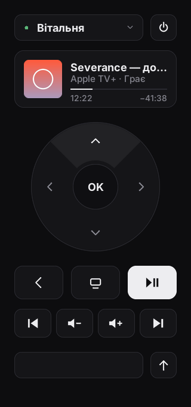

# Remote for Apple TV (unofficial)

A small, restrained dark remote for Apple TV on macOS. Python + tkinter + [pyatv](https://github.com/postlund/pyatv).



*Screenshot: interface preview rendered with a placeholder cover.*

## Features

- Finds Apple TVs on your network and pairs with a PIN
- D-pad, OK, Back, TV/Home, play/pause, previous/next, volume, power
- Text entry for on-screen keyboards
- "Now playing" card with cover art, title, app and a progress bar
- Keyboard control: arrows, Enter (OK), Esc (Back), Space (play/pause)
- Experimental: shows Apple TV in the macOS Control Center "Now Playing" widget, with transport buttons and a scrubber

## Requirements

- macOS, Python 3.9+ (the installer from python.org is recommended — it ships a modern Tk)
- Apple TV and Mac on the same network (allow *Local Network* access when macOS asks)

## Run

```bash
git clone https://github.com/poohovskiy/appletv-remote-macos.git
cd appletv-remote-macos
python3 -m venv .venv
./.venv/bin/pip install -r requirements.txt
./.venv/bin/python appletv_remote.py
```

Pick your Apple TV in the top bar, press the entry to pair, and type the PIN shown on the TV (you may be asked twice: Companion and AirPlay).
Pairing data is stored in `~/.appletv_remote.json` on your machine only — never in this repository.

Closing the window only hides it (so Control Center keeps working); quit with `Cmd+Q`.

## Build a standalone app

```bash
./build_app.sh
```

Creates `dist/Apple TV Remote.app` and a zip you can share. The app is not signed with an Apple Developer ID, so on first launch use right-click → Open (or *Open Anyway* in System Settings → Privacy & Security). It is built for the CPU architecture of the machine you build on.

## Notes

- Unofficial project, not affiliated with or endorsed by Apple. Apple TV is a trademark of Apple Inc.
- Seeking and the Control Center integration depend on the app that is playing on the Apple TV and on macOS, and are experimental.
- Built on [pyatv](https://github.com/postlund/pyatv) (MIT).

## License

MIT — see [LICENSE](LICENSE).

---

## Українською

Невеликий стриманий темний пульт для Apple TV на macOS (Python, tkinter, pyatv).

**Запуск:** встановіть залежності з `requirements.txt` у віртуальне середовище і виконайте `./.venv/bin/python appletv_remote.py` (команди вище). Для спарювання виберіть Apple TV у верхній панелі та введіть PIN з екрана ТВ.
Дані спарювання зберігаються лише локально в `~/.appletv_remote.json`.
Закриття вікна лише ховає його, повний вихід — `Cmd+Q`. Автономний застосунок збирається командою `./build_app.sh`.
Це неофіційний проєкт, не пов'язаний з Apple.
